<picture><source media="(prefers-color-scheme: dark)" srcset="assets/dark/header.svg"/></picture>

<a href="https://linkedin.com/in/alessandrogalvaosilva"><picture><source media="(prefers-color-scheme: dark)" srcset="https://img.shields.io/badge/LINKEDIN-0d1117?style=flat-square&logo=linkedin&logoColor=ffffff"/></picture></a>
<a href="https://github.com/Alezin777"><picture><source media="(prefers-color-scheme: dark)" srcset="https://img.shields.io/badge/GITHUB-0d1117?style=flat-square&logo=github&logoColor=ffffff"/></picture></a>
<a href="mailto:alessandro.galvao01@outlook.com"><picture><source media="(prefers-color-scheme: dark)" srcset="https://img.shields.io/badge/EMAIL-0d1117?style=flat-square&logoColor=ffffff"/></picture></a>

<picture><source media="(prefers-color-scheme: dark)" srcset="assets/dark/s01.svg"/></picture>
<picture><source media="(prefers-color-scheme: dark)" srcset="assets/dark/whoami.svg"/></picture>
<picture><source media="(prefers-color-scheme: dark)" srcset="assets/dark/s02.svg"/></picture>
<picture><source media="(prefers-color-scheme: dark)" srcset="assets/dark/ecosystem.svg"/></picture>
<picture><source media="(prefers-color-scheme: dark)" srcset="assets/dark/s03.svg"/></picture>
<picture><source media="(prefers-color-scheme: dark)" srcset="assets/dark/projects.svg"/></picture>

<a href="https://github.com/VitorGabrielFS/multi-touch"><picture><source media="(prefers-color-scheme: dark)" srcset="https://img.shields.io/badge/SEEME-0d1117?style=flat-square&logo=github&logoColor=ffffff"/></picture></a>
<a href="https://github.com/Alezin777/GPT-Azure"><picture><source media="(prefers-color-scheme: dark)" srcset="https://img.shields.io/badge/CHATBOT_AZURE-0d1117?style=flat-square&logo=github&logoColor=ffffff"/></picture></a>
<a href="https://github.com/Alezin777/tcc"><picture><source media="(prefers-color-scheme: dark)" srcset="https://img.shields.io/badge/SABORETECIA-0d1117?style=flat-square&logo=github&logoColor=ffffff"/></picture></a>
<a href="https://grupofecontabil.com.br"><picture><source media="(prefers-color-scheme: dark)" srcset="https://img.shields.io/badge/GRUPO_F%C3%89-0d1117?style=flat-square&logo=googlechrome&logoColor=ffffff"/></picture></a>

<picture><source media="(prefers-color-scheme: dark)" srcset="assets/dark/s04.svg"/></picture>
<picture><source media="(prefers-color-scheme: dark)" srcset="assets/dark/telemetry.svg"/></picture>

<picture><source media="(prefers-color-scheme: dark)" srcset="https://github-readme-stats.vercel.app/api?username=Alezin777&show_icons=true&hide_border=true&bg_color=00000000&include_all_commits=true&title_color=ffffff&icon_color=ffffff&text_color=ffffff"/></picture>
<picture><source media="(prefers-color-scheme: dark)" srcset="https://github-readme-stats.vercel.app/api/top-langs/?username=Alezin777&layout=compact&hide_border=true&bg_color=00000000&title_color=ffffff&icon_color=ffffff&text_color=ffffff"/></picture>

<picture><source media="(prefers-color-scheme: dark)" srcset="https://github-readme-activity-graph.vercel.app/graph?username=Alezin777&bg_color=00000000&area=true&hide_border=true&radius=0&custom_title=TELEMETRIA%20DE%20CONTRIBUI%C3%87%C3%95ES&color=ffffff&line=ffffff&point=ffffff&area_color=ffffff"/></picture>

<picture><source media="(prefers-color-scheme: dark)" srcset="assets/dark/s05.svg"/></picture>
<picture><source media="(prefers-color-scheme: dark)" srcset="assets/dark/experience.svg"/></picture>
<picture><source media="(prefers-color-scheme: dark)" srcset="assets/dark/s06.svg"/></picture>
<picture><source media="(prefers-color-scheme: dark)" srcset="assets/dark/stack.svg"/></picture>
<picture><source media="(prefers-color-scheme: dark)" srcset="assets/dark/footer.svg"/></picture>

<!-- uma imagem responsiva por visual; versões clara e escura via <picture> -->
